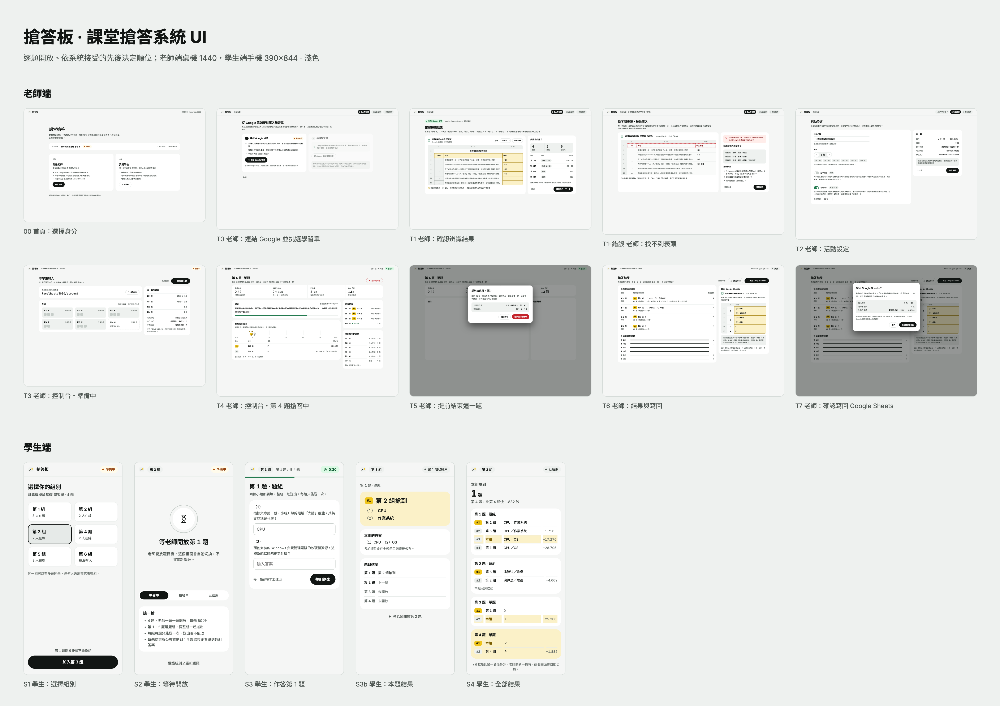

# 課堂搶答系統（SpecKit 組）

## 系統簡介

老師從 Google Sheets 匯入填空式學習單（Guided Notes），學生以組為單位線上搶答，
由系統判定最快送出的組別，搶答結束後把成功的答案寫回原學習單的填空格。
系統在本機執行，以多個瀏覽器分頁模擬老師與各組學生。

本專案以 SpecKit 進行規格驅動開發，並導入 Diagram First Development。

<picture>
  <source media="(prefers-color-scheme: dark)" srcset="docs/images/ui-overview-dark.png">
  
</picture>

## Repo 內容

| 路徑 | 用途 |
| --- | --- |
| `.specify/` | SpecKit 設定與範本；專案憲法在 `memory/constitution.md` |
| `.claude/` | Claude Code 的 SpecKit 指令、commit 檢查 skill 與專案共用設定 |
| `docs/assignment.md` | 作業說明中與系統相關段落的原文摘錄，以及助教補充的原文 |
| `docs/templates/` | 助教提供的 Guided Notes 範本樣本，供規格分析使用 |
| `specs/NNN-*/` | 三個子功能的 spec、plan、research、data-model、contracts、quickstart |
| `diagrams/` | 每個子功能的組件圖、類別圖、時序圖（PlantUML 與 PNG） |
| `docs/design/` | 每個畫面的 HTML 設計稿（全黑與淺色主題） |
| `docs/work-split.md` | 兩人分工、檔案歸屬與時程 |
| `CONTRIBUTING.md` | Git 協作規範 |
| `CLAUDE.md` | Claude Code 的工作規則：規則來源、功能開發流程、停止條件 |
